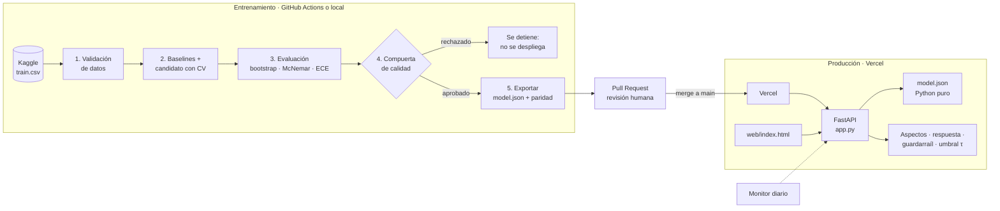
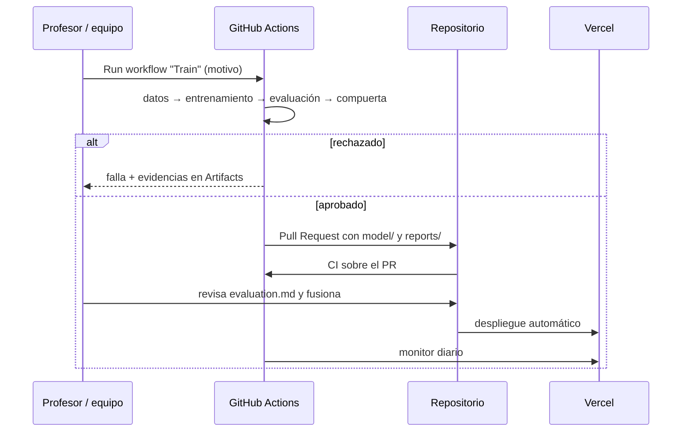

# Traveler Insights

**Solución de Procesamiento de Lenguaje Natural para reseñas de viajeros**: clasifica cada reseña, detecta de qué aspecto habla (limpieza, servicio, precio…), sugiere una respuesta y decide si puede automatizarse o debe revisarla una persona.

El proyecto se desarrolla con la metodología **CRISP-ML(Q)** y se opera con prácticas de **MLOps en GitHub Actions**. El modelo se entrena con scikit-learn, pasa una compuerta de calidad, se exporta a un formato liviano y se despliega como app web en **Vercel**.

> Proyecto docente del curso de Procesamiento de Lenguaje Natural, basado en la competencia de Kaggle *Traveler Insights UPTC 2026*.
>
> 📄 **Guía completa en PDF:** [`docs/Guia_TravelerInsights_v1.2.pdf`](docs/Guia_TravelerInsights_v1.2.pdf) · App: https://traveler-insights.vercel.app

---

## Contenido
1. [Funcionalidades](#1-funcionalidades)
2. [Arquitectura](#2-arquitectura)
3. [CRISP-ML(Q) en este repositorio](#3-crisp-mlq-en-este-repositorio)
4. [Estructura del repositorio](#4-estructura-del-repositorio)
5. [Guía paso a paso](#5-guía-paso-a-paso)
6. [MLOps con GitHub Actions](#6-mlops-con-github-actions)
7. [Despliegue en Vercel](#7-despliegue-en-vercel)
8. [API](#8-api)
9. [Cómo se evalúa el modelo](#9-cómo-se-evalúa-el-modelo)
10. [Cómo agregar una funcionalidad](#10-cómo-agregar-una-funcionalidad)
11. [Datos, privacidad y uso responsable](#11-datos-privacidad-y-uso-responsable)
12. [Solución de problemas](#12-solución-de-problemas)
13. [Referencias](#13-referencias)

---

## 1. Funcionalidades

Esta tabla es el registro vivo del proyecto. Cada nueva funcionalidad se agrega aquí en el mismo Pull Request que la implementa (ver [sección 10](#10-cómo-agregar-una-funcionalidad)).

| Versión | Funcionalidad | Fase CRISP-ML(Q) | Dónde está |
|---|---|---|---|
| 1.0 | Validación de calidad de datos (vacíos, duplicados, etiquetas contradictorias, tamaño por clase) | 2 · Datos | `src/traveler_insights/ml/data.py` |
| 1.0 | Baselines (clase mayoritaria, TF-IDF + Naive Bayes) y modelo candidato TF-IDF palabras + caracteres + regresión logística | 3 · Modelado | `src/traveler_insights/ml/train.py` |
| 1.0 | Evaluación: validación cruzada, IC por bootstrap, prueba de McNemar, calibración (ECE), desempeño por subgrupo, curva de umbral τ | 4 · Evaluación | `src/traveler_insights/ml/evaluate.py` |
| 1.0 | Compuerta de calidad: macro-F1 mínimo, mejora sobre el baseline, no regresión frente a producción, paridad del modelo exportado | 4 · Evaluación | `configs/params.yaml`, `pipeline.py` |
| 1.0 | Exportación del modelo a JSON e inferencia en Python puro (sin scikit-learn en producción) | 5 · Despliegue | `ml/export.py`, `core/model.py` |
| 1.0 | Detección de aspectos, respuesta sugerida por plantilla y guardarraíl contra compromisos indebidos | 5 · Despliegue | `core/business.py` |
| 1.0 | Humano en el bucle: enrutamiento por umbral de confianza τ | 5 · Despliegue | `core/business.py` |
| 1.0 | API FastAPI y app web (reseña individual, lote CSV, impacto, ficha del modelo) | 5 · Despliegue | `app.py`, `web/index.html` |
| 1.0 | CI, entrenamiento continuo con PR, despliegue y monitoreo de salud | 6 · Operación | `.github/workflows/` |
| 1.1 | Notebook del pipeline paso a paso: evaluación, pruebas de comportamiento sobre reseñas reales, exportación, integración con la API y deriva (PSI) con `test.csv` | 2–6 | `notebooks/TravelerInsights_Pipeline_CRISP-MLQ.ipynb` |
| 1.2 | Rasgos léxicos de los modelos anteriores del curso (léxico de `lexical_features.py` de courseNLP: pronombres, adverbios de negación/tiempo/lugar/modo/cantidad, adjetivos, personas, odio y estadísticas de palabras), con 4 correcciones documentadas, unidos al TF-IDF y evaluados por ablación (con vs. sin léxico) | 3–5 | `core/lexical.py`, `ml/lexical.py`, `params.yaml › model.lexical_features` |
| 1.4 | **micro-F1 y macro-F1** en la ficha del modelo (la compuerta sigue usando macro-F1 por el desbalance de clases) | 4 · Evaluación | `ml/evaluate.py`, `app.py › /api/model` |
| 1.4 | **Historial de reseñas** que se refresca al analizar (Upstash Redis; respaldo en el navegador si no está configurado) | 5 · Despliegue | `core/store.py`, `/api/history` |
| 1.4 | **Retroalimentación humana** (*human feedback loop*): corrección de clase y edición de la respuesta; las correcciones se agregan **solo al entrenamiento** del siguiente `train.yml` y el modelo debe volver a pasar la compuerta | 5–6 | `core/feedback.py`, `/api/feedback`, `scripts/export_feedback.py`, `pipeline.py` |
| 1.4 | Métricas de producción: micro/macro-F1 contra las correcciones humanas y **BLEU / ROUGE-1/2/L** entre la respuesta sugerida y la editada | 4–6 | `core/textmetrics.py`, `/api/feedback/stats` |
| 1.4 | **Análisis de emociones** con el léxico afectivo de los modelos previos (SEL + NRC, 8 emociones) | 5 · Despliegue | `core/emotions.py`, `core/data/emociones.json` |
| 1.4 | **NER visual y árbol de dependencias** con spaCy/displaCy en un servicio aparte (Hugging Face Spaces) | 5 · Despliegue | `services/spacy-displacy/`, `spacy-space.yml` |
| 1.7 | **Balanceo SMOTE + submuestreo** al promedio de las dos clases menores (dentro de cada pliegue, solo entrenamiento) y **datos externos reales** (OpeNER-es, oraciones negativas de reseñas de hoteles) solo para entrenar; ablaciones: sin balanceo ni externos, solo SMOTE, solo externos | 2–4 | `ml/balance.py`, `scripts/fetch_external.py`, `params.yaml › model.resampling, data.external` |
| 1.6 | **Evaluación fuera de pliegue** (`test_split: cv`): cada reseña se predice con un modelo que no la vio, 5 pliegues × 5 repeticiones; soporte = dataset completo (630 / 157 / 22). La compuerta usa ese macro-F1 | 4 · Evaluación | `params.yaml › data.test_split`, `ml/evaluate.py › predicciones_oof` |
| 1.5 | **Prueba con soporte balanceado** (7 reseñas por clase) y **evaluación repetida** en 30 particiones balanceadas (media ± DE, percentiles 2.5–97.5); la compuerta marca como *no comparable* la regresión frente a producción cuando cambia la partición | 4 · Evaluación | `params.yaml › data.test_split`, `ml/evaluate.py` |
| 1.3 | Notebook **independiente** (sin API de Kaggle ni módulos del repo): modelo base TF-IDF + léxico → word embeddings FastText → Transformer BETO, con las 6 fases de CRISP-ML(Q), comparación justa (bootstrap, McNemar, calibración, costo), compuerta y despliegue (FastAPI, Docker/Hugging Face Spaces) | 1–6 | `notebooks/TravelerInsights_TFIDF_Embeddings_Transformer_CRISP-MLQ.ipynb` |

**Siguientes funcionalidades sugeridas:** reemplazar el modelo por el Transformer afinado del proyecto integrador (sección 10), registro anónimo de predicciones para medir deriva y análisis de sentimiento por aspectos con un modelo.

---

## 2. Arquitectura



**Decisión de diseño clave:** scikit-learn y sus dependencias son demasiado pesados para una función serverless. Por eso el modelo entrenado se exporta a JSON (vocabulario, IDF y pesos), y la inferencia se reimplementa en Python puro. Las pruebas `tests/test_text_parity.py` y `tests/test_parity.py` garantizan que las probabilidades son las mismas que las de scikit-learn (error < 10⁻⁴). En producción solo se instala `fastapi`.

---

## 3. CRISP-ML(Q) en este repositorio

CRISP-ML(Q) (Studer et al., 2021) extiende CRISP-DM con **aseguramiento de calidad en cada fase**: para cada una se definen requisitos, riesgos y criterios de aceptación *antes* de trabajar. La documentación detallada de cada fase está en [`docs/crisp-mlq/`](docs/crisp-mlq/).

| Fase | Pregunta | Evidencia en el repo | Control de calidad |
|---|---|---|---|
| 1. Negocio y datos | ¿Qué decisión cambia? ¿Cómo se mide el éxito? | [`docs/crisp-mlq/01_entendimiento.md`](docs/crisp-mlq/01_entendimiento.md) | Métricas de negocio y técnicas definidas antes de modelar |
| 2. Preparación de datos | ¿Los datos son confiables? | `ml/data.py` → `reports/data_quality.json` | Requisitos en `params.yaml › data.quality`; si fallan, el pipeline se detiene |
| 3. Modelado | ¿Qué tan bien funciona frente a lo simple? | `ml/train.py` | Baselines obligatorios, validación cruzada con semilla fija |
| 4. Evaluación | ¿La mejora es real y suficiente? | `ml/evaluate.py` → `reports/metrics.json`, `reports/evaluation.md` | Compuerta en `params.yaml › quality_gate` |
| 5. Despliegue | ¿Se comporta igual en producción? | `ml/export.py`, `app.py`, `model/MODEL_CARD.md` | Paridad sklearn ↔ JSON, pruebas de API, revisión humana del PR |
| 6. Monitoreo y mantenimiento | ¿Sigue funcionando? | `.github/workflows/monitor.yml`, `train.yml` | Prueba de humo diaria; reentrenamiento con la misma compuerta |

**Trazabilidad:** cada modelo guarda la huella SHA-256 de los datos, la configuración completa, las versiones de Python y scikit-learn, y la fecha (`model/metrics.json › run`). Cambiar el modelo solo es posible editando `configs/params.yaml` y volviendo a ejecutar el pipeline.

---

## 4. Estructura del repositorio

```
TravelerInsights/
├── app.py                      # API FastAPI + app web (entrypoint de Vercel)
├── web/index.html              # interfaz web (sin dependencias externas)
├── model/                      # modelo DESPLEGADO: model.json, metrics.json, MODEL_CARD.md
├── reports/                    # evidencias de la última ejecución del pipeline
├── configs/params.yaml         # única fuente de verdad de datos, modelo y compuerta
├── src/traveler_insights/
│   ├── core/                   # se despliega: Python puro
│   │   ├── text.py             # normalización y n-gramas idénticos a scikit-learn
│   │   ├── lexical.py          # rasgos léxicos del curso (Python puro)
│   │   ├── model.py            # inferencia desde model.json
│   │   └── business.py         # aspectos, respuestas, guardarraíl, umbral τ
│   ├── ml/                     # NO se despliega: entrenamiento
│   │   ├── data.py             # fase 2
│   │   ├── train.py            # fase 3
│   │   ├── evaluate.py         # fase 4
│   │   └── export.py           # fase 5
│   └── pipeline.py             # orquesta las fases 2–5
├── tests/                      # pruebas automáticas (pytest)
├── docs/crisp-mlq/             # documentación por fase
├── notebooks/                  # pipeline CRISP-ML(Q) paso a paso + notebook docente de la semana 12
├── data/README.md              # cómo obtener los datos (no se versionan)
├── .github/workflows/          # ci · train · deploy · monitor
├── pyproject.toml              # dependencias: producción, entrenamiento y desarrollo
└── .vercelignore               # qué no se sube a Vercel
```

---

## 5. Guía paso a paso

### 5.1 Requisitos
- Python 3.12 o superior y Git.
- Cuenta de Kaggle con las reglas de la competencia *Traveler Insights UPTC 2026* aceptadas.
- Cuenta de GitHub y cuenta de Vercel (el plan gratuito sirve).

### 5.2 Clonar e instalar
```bash
git clone https://github.com/<su-usuario>/TravelerInsights.git
cd TravelerInsights
python -m venv .venv
# Windows: .venv\Scripts\activate    ·    macOS/Linux: source .venv/bin/activate
pip install -e ".[train,dev]"
pytest -q                     # todo debe pasar antes de empezar
```

### 5.3 Obtener los datos
1. En https://www.kaggle.com/settings, sección **API Tokens**, pulse **Generate New Token** y copie el token (empieza por `KGAT_`).
2. Guárdelo en `~/.kaggle/access_token` (Windows: `C:\Users\<usuario>\.kaggle\access_token`) o en la variable de entorno `KAGGLE_API_TOKEN`.
   *Alternativa antigua:* **Create Legacy API Key** descarga `kaggle.json`; guárdelo en `~/.kaggle/kaggle.json`.
3. Descargue y descomprima:
```bash
kaggle competitions download -c traveler-insights-uptc-2026 -p data/raw
cd data/raw && unzip -o *.zip && cd ../..
```

### 5.4 Revisar la configuración
Abra `configs/params.yaml`:
- `data.text_col` y `data.label_col`: déjelos en `null` para detección automática o escriba los nombres reales de las columnas.
- `quality_gate.min_macro_f1`: el mínimo aceptable **para el negocio**. Defínalo antes de entrenar, no después de ver el resultado.
- `serving.tau`: umbral de confianza con el que arranca la app.

### 5.5 Entrenar y evaluar
```bash
python -m traveler_insights.pipeline --config configs/params.yaml
```
La salida muestra cada fase con ✔/✘. Revise:
- `reports/data_quality.json`: calidad de los datos.
- `reports/evaluation.md`: comparación con baselines, intervalo de confianza, McNemar, calibración y subgrupos.
- `model/MODEL_CARD.md`: ficha del modelo aprobado.

Si la compuerta rechaza el modelo, el comando termina con código 1 y **no** modifica `model/`. Mejore los datos o la configuración y repita.

### 5.5 b · Recorrerlo en el notebook (opcional)
Abra `notebooks/TravelerInsights_Pipeline_CRISP-MLQ.ipynb`. Ejecuta las mismas fases con gráficas y explicaciones, y agrega pruebas de comportamiento, integración con la API y medición de deriva. Con `GUARDAR_MODELO = False` no modifica `model/`.

### 5.6 Probar la app en su computador
```bash
uvicorn app:app --reload
```
Abra http://127.0.0.1:8000. La documentación interactiva de la API está en http://127.0.0.1:8000/docs.

### 5.7 Versionar el modelo aprobado
```bash
git checkout -b model/primer-entrenamiento
git add model/ reports/
git commit -m "model: primer modelo aprobado"
git push -u origin model/primer-entrenamiento
```
Abra un Pull Request. CI verifica que el modelo cargue y que haya pasado la compuerta. Al fusionarlo a `main`, Vercel despliega.

> **Antes de subir `model/` revise las reglas de la competencia.** El modelo contiene vocabulario derivado de los datos. Si la competencia no permite redistribuirlo, mantenga el repositorio **privado**.

---

## 6. MLOps con GitHub Actions

| Workflow | Cuándo corre | Qué hace |
|---|---|---|
| `ci.yml` | Cada push y Pull Request | Lint (ruff), pruebas (paridad, negocio, API, pipeline) y contrato del modelo versionado |
| `train.yml` | Manual (*Actions → Train → Run workflow*); opcional mensual | Descarga datos de Kaggle → pipeline con compuerta → guarda evidencias → **abre un PR** con el modelo aprobado |
| `deploy.yml` | Push a `main` (opcional) | Despliega en Vercel con su CLI. Úselo solo si no usa la integración de Git de Vercel |
| `monitor.yml` | Diario | Prueba de humo contra la app desplegada (`/api/health` y una predicción) |
| `spacy-space.yml` | Manual o push a `services/spacy-displacy/` | Publica el servicio spaCy/displaCy en Hugging Face Spaces |

### 6.1 Configuración (una sola vez)
En GitHub: *Settings → Secrets and variables → Actions*.

| Tipo | Nombre | Valor | Para |
|---|---|---|---|
| Secret | `KAGGLE_API_TOKEN` | token de *kaggle.com/settings → API Tokens → Generate New Token* (empieza por `KGAT_`) | `train.yml` (recomendado) |
| Secret *(alternativa)* | `KAGGLE_USERNAME` y `KAGGLE_KEY` | usuario y `key` de `kaggle.json` (*Create Legacy API Key*) | `train.yml` |
| Variable | `APP_URL` | URL de producción de Vercel, sin `/` final | `monitor.yml` |
| Variable *(opcional)* | `DEPLOY_WITH_ACTIONS` | `true` | `deploy.yml` |
| Secret *(opcional)* | `VERCEL_TOKEN`, `VERCEL_ORG_ID`, `VERCEL_PROJECT_ID` | ver sección 7.3 | `deploy.yml` |
| Secret *(opcional)* | `KV_REST_API_URL`, `KV_REST_API_TOKEN` | los mismos de Upstash en Vercel (sección 7.4) | `train.yml` (exporta la retroalimentación) |
| Secret *(opcional)* | `HF_TOKEN` | token de Hugging Face con permiso *write* | `spacy-space.yml` |
| Variable *(opcional)* | `HF_SPACE` | `usuario/traveler-insights-spacy` | `spacy-space.yml` |

Además, en *Settings → Actions → General → Workflow permissions*, active **Allow GitHub Actions to create and approve pull requests** para que `train.yml` pueda abrir el PR.

### 6.2 Ciclo de vida de un modelo


La **revisión humana del PR** es un control deliberado: nadie despliega un modelo solo porque una métrica superó un umbral.

---

## 7. Despliegue en Vercel

Vercel detecta automáticamente la instancia FastAPI `app` en `app.py` y la sirve como una función. Solo instala las dependencias de producción de `pyproject.toml` (`fastapi`). `.vercelignore` excluye datos, pruebas, notebooks y el código de entrenamiento.

### 7.1 Con la integración de Git (recomendado)
1. Entre a https://vercel.com/new e inicie sesión con GitHub.
2. Importe el repositorio `TravelerInsights`. Si es privado, autorice a Vercel a verlo.
3. *Framework Preset*: Vercel debe detectar **FastAPI**; no configure comando de build ni directorio de salida.
4. Pulse **Deploy**.
5. Copie la URL de producción y guárdela como variable `APP_URL` en GitHub (sección 6.1).

Desde ese momento:
- cada push a `main` despliega a producción;
- cada Pull Request recibe una URL de vista previa para probar el modelo nuevo antes de fusionarlo.

### 7.2 Verificar el despliegue
```bash
curl https://<su-app>.vercel.app/api/health
curl -X POST https://<su-app>.vercel.app/api/analyze \
  -H "Content-Type: application/json" \
  -d '{"texts": ["La habitación estaba sucia y el personal fue grosero"]}'
```

### 7.3 Con GitHub Actions (alternativa)
1. Instale la CLI (`npm i -g vercel`) y ejecute `vercel link` en el repositorio. Se crea `.vercel/project.json` con `orgId` y `projectId`.
2. Cree un token en *Vercel → Account Settings → Tokens*.
3. Guarde `VERCEL_TOKEN`, `VERCEL_ORG_ID` y `VERCEL_PROJECT_ID` como secretos, y la variable `DEPLOY_WITH_ACTIONS = true`.
4. Desactive la integración de Git en Vercel para no desplegar dos veces.

### 7.4 Historial y retroalimentación (Upstash Redis)
1. En Vercel: *Project → Storage → Create Database → Upstash for Redis* (plan gratuito) y conéctela al proyecto. Vercel crea `KV_REST_API_URL` y `KV_REST_API_TOKEN`.
2. *Deployments → Redeploy*. `/api/health` debe mostrar `"store": true`.
3. Copie esas dos variables como **secretos** en GitHub para que `train.yml` incorpore la retroalimentación.

Sin Upstash la app funciona igual: guarda historial y retroalimentación **solo en el navegador** (localStorage), y ese feedback no llega al reentrenamiento salvo que exporte el CSV y lo copie a `data/feedback/feedback.csv`.

### 7.5 NER y dependencias con spaCy (Hugging Face Spaces)
spaCy con `es_core_news_sm` no cabe en el límite de tamaño de una función de Vercel, así que corre aparte:
1. Cree un token *write* en https://huggingface.co/settings/tokens y guárdelo como secreto `HF_TOKEN`; cree la variable `HF_SPACE` (por ejemplo `EdwinPuertas/traveler-insights-spacy`).
2. *Actions → spaCy Space → Run workflow*. El primer build tarda unos minutos.
3. En Vercel agregue la variable `SPACY_SERVICE_URL = https://<usuario>-traveler-insights-spacy.hf.space` y redepliegue.

Prueba local: `cd services/spacy-displacy && pip install -r requirements.txt && uvicorn app:app --port 7860`.

---

## 8. API

| Método | Ruta | Descripción |
|---|---|---|
| GET | `/` | App web |
| GET | `/api/health` | Estado y si hay modelo cargado |
| GET | `/api/model` | Clases, metadatos, métricas de prueba, curva τ y compuerta |
| POST | `/api/analyze` | Analiza hasta 200 reseñas; incluye perfil de emociones. Guarda en el historial si es una sola reseña o `save: true` |
| GET | `/api/history` | Últimas reseñas analizadas (hasta 500) |
| POST | `/api/feedback` | Clase correcta, respuesta editada y comentario; devuelve BLEU/ROUGE de esa respuesta |
| GET | `/api/feedback/stats` | micro/macro-F1 contra correcciones humanas, matriz de errores, BLEU y ROUGE promedio |
| GET | `/api/config` | Si hay almacenamiento y la URL del servicio spaCy |
| GET | `/docs` | Documentación interactiva (OpenAPI) |

Ejemplo de respuesta de `/api/analyze` (valores ilustrativos):
```json
{
  "tau": 0.7,
  "results": [{
    "texto": "La habitación estaba sucia y el personal fue grosero",
    "clase": "negativo",
    "confianza": 0.93,
    "polaridad": "negativa",
    "aspectos": ["limpieza", "servicio", "instalaciones"],
    "respuesta_sugerida": "Lamentamos tu experiencia sobre ...",
    "decision": "automatizar",
    "motivos": []
  }]
}
```
Con Upstash configurado, la API **sí guarda** las reseñas individuales en el historial, visible para cualquiera que abra la app. No pegue datos personales; en un uso real, proteja la app con autenticación o desactive el historial.

---

## 9. Cómo se evalúa el modelo

| Nivel | Qué se mide | Dónde |
|---|---|---|
| Técnico | Macro-F1 (métrica principal), exactitud, reporte por clase, matriz de confusión; validación cruzada estratificada (media ± desviación) | `reports/metrics.json` |
| Comparación justa | Mismas particiones para baselines y candidato; IC 95 % por bootstrap; prueba de McNemar frente a Naive Bayes | `reports/evaluation.md` |
| Comportamiento | Desempeño por longitud de reseña; calibración (ECE y curva de fiabilidad) | `reports/metrics.json › candidate` |
| Operación | Cobertura y exactitud por umbral τ; prueba de humo diaria | App → pestaña *Impacto*; `monitor.yml` |

¿Por qué macro-F1? Las clases suelen estar desbalanceadas. La exactitud premia predecir la clase mayoritaria; macro-F1 pesa igual a cada clase.

---

## 10. Cómo agregar una funcionalidad

1. Cree una rama: `git checkout -b feat/<nombre>`.
2. Decida a qué fase de CRISP-ML(Q) pertenece y actualice su documento en `docs/crisp-mlq/`: requisito, riesgo y criterio de aceptación.
3. Implemente:
   - el código de producción va en `core/` y en Python puro;
   - el de entrenamiento va en `ml/`.
4. Agregue pruebas en `tests/` y ejecute `ruff check . && pytest -q`.
5. Agregue una fila a la tabla de [Funcionalidades](#1-funcionalidades).
6. Abra el Pull Request y complete la lista de chequeo de la plantilla.

**Ejemplo: usar el Transformer afinado del proyecto integrador.** Un Transformer no cabe en una función de Vercel con dependencias livianas. Hay dos opciones:
- **Opción A:** servirlo en Hugging Face Inference Endpoints o Spaces, y que `core/` lo llame por HTTP. La ventaja es la calidad; la desventaja, el costo y la latencia.
- **Opción B:** destilar su conocimiento en este modelo lineal, reentrenándolo con etiquetas del Transformer. Es barato y rápido, pero suele perder calidad.

En ambos casos el Transformer debe pasar la misma compuerta de calidad.

---

## 11. Datos, privacidad y uso responsable
- Los datos de Kaggle **no se versionan**. Respete las reglas de la competencia.
- Las respuestas son **sugerencias**. La plantilla nunca promete reembolsos, descuentos ni plazos, y el guardarraíl envía a revisión humana cualquier respuesta con compromisos.
- Limitaciones conocidas: ironía, negación, reseñas mixtas y variedades del español. El léxico de aspectos no cubre todas las reseñas.
- Revise `model/MODEL_CARD.md` antes de usar el modelo en otro contexto.
- **Retroalimentación humana ≠ RLHF.** No hay modelo de recompensa ni aprendizaje por refuerzo: las correcciones se convierten en ejemplos supervisados. Entran solo al entrenamiento (nunca a la prueba) y el modelo nuevo debe superar la compuerta y la revisión del PR. Vigile correcciones sesgadas o maliciosas antes de fusionar.
- **SMOTE y datos externos:** SMOTE crea vectores sintéticos en el espacio TF-IDF (no textos) y solo durante el entrenamiento; la evaluación usa únicamente reseñas reales de Kaggle. OpeNER-es son oraciones de hoteles de España, no reseñas completas de la costa colombiana: hay cambio de dominio, y las ablaciones muestran si ayuda. Verifique la licencia de OpeNER-es (redistribuido en SemEval-2022 Task 10) antes de un uso comercial. Otras fuentes posibles: Rest-Mex 2023 (TripAdvisor, incluye Colombia; requiere registro) y COAR (CC BY-NC-SA 4.0, acceso con aceptación de condiciones en Hugging Face).
- **Soporte de evaluación:** no es posible tener 100 reseñas negativas de prueba porque el dataset solo tiene 22. Por eso la evaluación es fuera de pliegue: todas las reseñas cuentan, pero la clase negativa sigue teniendo 22 casos y su métrica tiene mucha incertidumbre.
- **Prueba balanceada (opción `balanced`):** con 22 reseñas negativas, la prueba balanceada solo puede tener 7 por clase (21 en total), así que una sola partición es ruidosa; por eso se reporta también la media de 30 particiones. Las métricas balanceadas no reflejan la proporción real de producción (≈78 % neutral): para estimar el costo operativo use la curva τ y la retroalimentación en producción.
- **micro-F1** en clasificación multiclase de una sola etiqueta es igual a la exactitud; con 630 neutras, 157 positivas y 22 negativas puede verse alta aunque el modelo falle en negativas. Por eso la compuerta usa macro-F1.
- **BLEU y ROUGE** miden coincidencia de n-gramas con la respuesta editada por una persona, no si la respuesta es correcta, empática o segura.
- **Emociones por léxico:** cuentan palabras, no manejan negación ni ironía y heredan sesgos del léxico. Léxicos: SEL (Sidorov et al.) y NRC Emotion Lexicon (Mohammad & Turney), este último con licencia de uso en investigación/educación; revise la licencia antes de un uso comercial.

---

## 12. Solución de problemas

| Síntoma | Causa probable | Solución |
|---|---|---|
| `403` al descargar de Kaggle | No aceptó las reglas de la competencia | Acéptelas en la página de la competencia |
| El pipeline se detiene en la fase 1 | Columnas mal detectadas o datos que no cumplen los requisitos | Defina `text_col` y `label_col`; revise `reports/data_quality.json` |
| `json_parity` falla | Cambió el preprocesamiento sin actualizar `core/text.py` | Mantenga ambos alineados; ejecute `pytest tests/test_text_parity.py` |
| La app responde `503` | No hay `model/model.json` en `main` | Entrene y fusione el PR del modelo |
| `train.yml` no abre el PR | Permisos de Actions | *Settings → Actions → General → Allow GitHub Actions to create and approve pull requests* |
| Polaridad equivocada en las respuestas | Nombres de clase no reconocidos | Corrija `metadata.polarity` o amplíe `mapa_polaridad` en `core/business.py` |

---

## 13. Referencias
- Studer, S. et al. (2021). Towards CRISP-ML(Q): A Machine Learning Process Model with Quality Assurance Methodology. *Machine Learning and Knowledge Extraction*, 3(2), 392–413.
- Jurafsky, D. & Martin, J. H. *Speech and Language Processing* (3.ª ed., borrador). Cap. 4: Naive Bayes, clasificación de texto y sentimiento.
- Dietterich, T. G. (1998). Approximate Statistical Tests for Comparing Supervised Classification Learning Algorithms. *Neural Computation*, 10(7), 1895–1923.
- Guo, C., Pleiss, G., Sun, Y. & Weinberger, K. Q. (2017). On Calibration of Modern Neural Networks. *ICML 2017*.
- Ribeiro, M. T., Wu, T., Guestrin, C. & Singh, S. (2020). Beyond Accuracy: Behavioral Testing of NLP Models with CheckList. *ACL 2020*.
- Papineni, K., Roukos, S., Ward, T. & Zhu, W.-J. (2002). BLEU: a Method for Automatic Evaluation of Machine Translation. *ACL 2002*.
- Lin, C.-Y. (2004). ROUGE: A Package for Automatic Evaluation of Summaries. *Text Summarization Branches Out (ACL Workshop)*.
- Chawla, N. V., Bowyer, K. W., Hall, L. O. & Kegelmeyer, W. P. (2002). SMOTE: Synthetic Minority Over-sampling Technique. *JAIR*, 16, 321–357.
- Agerri, R., Cuadros, M., Gaines, S. & Rigau, G. (2013). OpeNER: Open Polarity Enhanced Named Entity Recognition. *Procesamiento del Lenguaje Natural*, 51, 215–218.
- Barnes, J. et al. (2022). SemEval 2022 Task 10: Structured Sentiment Analysis. *SemEval-2022*.
- Mohammad, S. M. & Turney, P. D. (2013). Crowdsourcing a Word–Emotion Association Lexicon. *Computational Intelligence*, 29(3), 436–465.
- Honnibal, M. et al. spaCy: Industrial-strength NLP (https://spacy.io) y displaCy.
- Documentación de Vercel: FastAPI on Vercel (https://vercel.com/docs/frameworks/backend/fastapi).
